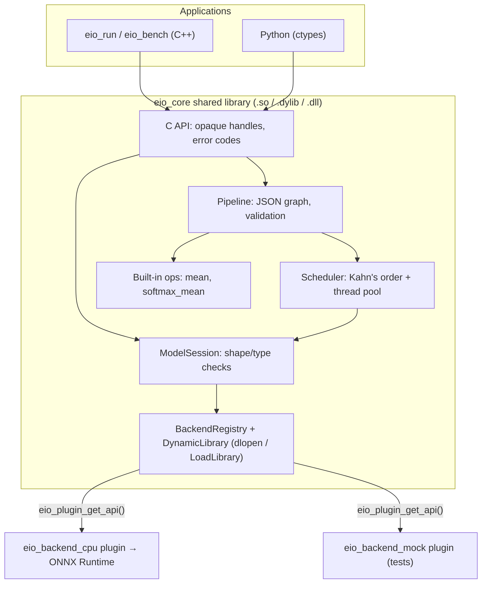

# Edge Inference Orchestrator

[](https://github.com/RITIKA-SHARMAA/edge-inference-orchestrator/actions/workflows/ci.yml)

A small, cross-platform C++17 SDK that loads ONNX models, runs several of them as a pipeline,
and compares normal (FP32) models with quantized (INT8) ones. It is a learning-sized version of
what an on-device AI orchestration SDK does: load models once, run them through pluggable
backends, schedule independent work in parallel, and expose everything through a stable C API.

**Stack:** C++17 · CMake · ONNX Runtime 1.20.1 (C++ API) · GoogleTest · nlohmann/json ·
Python (ctypes bindings, ONNX Runtime quantization, pytest) · GitHub Actions on Linux (GCC, Clang),
macOS (Clang) and Windows (MSVC) · AddressSanitizer + UBSan.

## What it does

```bash
$ build/bin/eio_run --model models/mobilenetv2.onnx --input samples/cat.npy --labels models/imagenet_labels.txt
output 'output' shape [1, 1000]
     19.0210  Egyptian cat
     17.4330  tiger cat
     17.3348  tabby, tabby cat
     ...

$ build/bin/eio_run --pipeline pipelines/example.json --input image=samples/cat.npy --threads 2 --labels models/imagenet_labels.txt --top 3
output 'probabilities' shape [1, 1000]
      0.7387  Egyptian cat
      0.1365  tiger cat
      0.1161  tabby, tabby cat

node timings (2 threads, ms since run start)
node             start       end      took
int8              3.64     13.81     10.17
fp32              0.06     15.07     15.01
combine          15.12     15.18      0.05
```

The pipeline runs the FP32 and INT8 versions of MobileNetV2 **in parallel**, then averages their
probabilities in a built-in step. Times above are from one run on a 2-thread cloud VM.

## Architecture



- **C API** (`include/eio/eio.h`): plain C functions and opaque handles, so any compiler or
  language can call the library. No C++ exception crosses it; every call returns an error code and
  `eio_last_error()` gives the message.
- **Plugins** (`include/eio/eio_plugin.h`): each backend is a separate shared library exporting one
  function that returns a versioned table of function pointers. The core finds plugins in a folder
  at runtime, so a new backend needs no rebuild of the core.
- **Pipelines** (`pipelines/*.json`): models and built-in steps wired into a graph. Loading checks
  for unknown nodes, unconnected inputs, shape mismatches along edges and cycles before anything runs.
- **Scheduler**: a node starts as soon as everything it depends on has finished, on a fixed-size
  thread pool, so independent branches run at the same time.

## Benchmark: FP32 vs INT8

From `docs/BENCHMARK.md` (Intel Xeon @ 2.80 GHz, 2 threads, Linux, GCC 13, ONNX Runtime CPU with
1 intra-op thread, batch size 1, 300 timed runs after 30 warm-up runs):

| Model | Precision | Size | p50 latency | p95 latency | Top-1 | Top-5 |
|---|---|---|---|---|---|---|
| MobileNetV2 | FP32 | 13.96 MB | 9.037 ms | 12.102 ms | reference | reference |
| MobileNetV2 | INT8 (static, QDQ, per-channel) | 3.83 MB | 4.839 ms | 7.761 ms | 85.7% agreement | 100% |
| Digits MLP | FP32 | 0.07 MB | 0.008 ms | 0.015 ms | 97.1% | 100% |
| Digits MLP | INT8 (dynamic) | 0.02 MB | 0.014 ms | 0.017 ms | 97.1% | 100% |

- INT8 MobileNetV2 is **72.5% smaller** and its median latency is **0.54x** of FP32.
- The tiny digits model gets **slower** in INT8: it is so small that quantize/dequantize overhead
  costs more than the 8-bit maths saves.
- There is no labelled ImageNet set here, so MobileNetV2 accuracy is measured as agreement with the
  FP32 model on 56 image crops. `docs/QUANTIZATION-NOTES.md` compares calibration choices.

## Build and run

Requirements: CMake 3.20+, a C++17 compiler, Python 3.12, internet for the first configure
(ONNX Runtime, GoogleTest and nlohmann/json are downloaded and pinned).

```bash
python -m venv .venv && source .venv/bin/activate      # Windows: .venv\Scripts\activate
pip install -r scripts/requirements.txt

python scripts/get_models.py       # MobileNetV2 + labels, trains the digits MLP
python scripts/prepare_data.py     # .npy inputs, evaluation and calibration crops
python scripts/quantize.py         # INT8 versions of both models

cmake -S . -B build -DCMAKE_BUILD_TYPE=Release
cmake --build build --config Release
ctest --test-dir build -C Release --output-on-failure
python -m pytest python/tests

build/bin/eio_run --list-backends
python scripts/benchmark.py        # writes results/bench.db and docs/BENCHMARK.md
```

Sanitizer build (Linux/macOS): `cmake -S . -B build-asan -DCMAKE_BUILD_TYPE=Debug -DEIO_SANITIZE=ON`,
then run the tests with `LSAN_OPTIONS=suppressions=$PWD/tests/lsan.supp`.

### From Python

```python
import sys; sys.path.insert(0, "python")
import numpy as np, eio

with eio.Runtime() as rt:                       # loads build/bin/plugins
    session = rt.session("models/mobilenetv2.onnx")
    logits = session.run({"input": np.load("samples/cat.npy")})["output"]
    print(logits.argmax())                      # 285 (Egyptian cat)
```

## Tests

| Suite | Count | Covers |
|---|---|---|
| `eio_unit_tests` (GoogleTest, C++ internals) | 43 | tensors and `.npy`, plugin loading and rejection of broken plugins, model sessions on real ONNX models, built-in ops, Kahn's sort and cycles, thread pool, parallel overlap, pipelines and their validation errors |
| `eio_c_api_tests` (GoogleTest, public C API only) | 7 | null arguments, error codes and messages, model and pipeline runs, timings |
| `python/tests` (pytest) | 7 | ctypes bindings, errors as Python exceptions, pipelines, MobileNetV2 |

CI runs all of them on Linux (GCC and Clang), macOS (Apple Silicon) and Windows (MSVC), plus a
Linux job under AddressSanitizer and UndefinedBehaviorSanitizer.

## Project layout

```
include/eio/        public headers: eio.h (C API), eio_plugin.h (plugin contract), eio_export.h
src/core/           the C++ implementation
src/plugins/        cpu_backend.cpp (ONNX Runtime), mock_backend.cpp (tests)
tools/              eio_run and eio_bench
python/eio/         ctypes bindings
scripts/            model download, data preparation, quantization, benchmark, report
pipelines/          example pipeline
tests/              GoogleTest suites, tiny ONNX/mock models, deliberately broken plugins
docs/               LEARNING.md, BENCHMARK.md, QUANTIZATION-NOTES.md, PROFILING.md, PITCH.md
```

## Limits

- Tensors crossing the C API are float32 only; models with other input or output types are
  rejected with a clear error.
- One CPU backend. A GPU or NPU backend would be another plugin implementing the same table.
- Each pipeline node copies its inputs (see `docs/PROFILING.md`); a pipeline runs one request at a time.
- Benchmarks come from a single machine and a small evaluation set of sample photos, not ImageNet.
